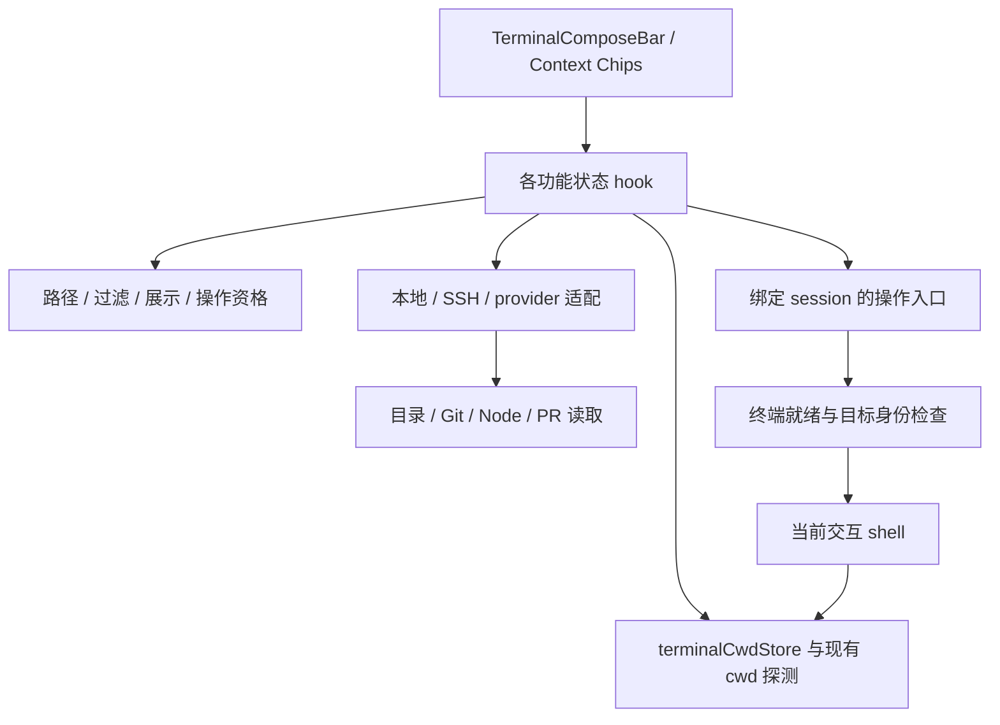

# Terminal Compose Context Chips

在终端撰写栏中增加 **Context Chips（上下文芯片）**，让用户在编写命令时直接查看和操作当前目录、Git 分支、变更统计、Node 版本及关联 PR。

## 开发目标

Context Chips 位于**快捷命令下方、命令输入区上方**，各芯片绑定当前聚焦的终端。首期实现目录切换，第二步增加 Git 功能，随后增加 Node 和 PR；详细 Git 变更面板暂不实现，但预留入口。

```text
撰写栏调高把手
快捷命令／固定片段                                      管理
Context Chips： [目录] [分支] [变更统计] [Node] [PR]
命令输入区                                             关闭
```

芯片显示上下文，点击就近操作。首期只显示已实现的目录芯片，其余按终端能力与上下文出现。共享终端主题、紧凑图标和文字、悬停说明及键盘焦点；不额外显示占据高度的行标题。窄分屏优先保留目录，长路径／分支名截断显示，完整值可查看。

| 功能 | 开发目标 | 调研与交互 |
| --- | --- | --- |
| Directory Picker | 显示当前位置；搜索子目录、返回父目录、选择后立即切换并关闭菜单 | [directory-picker.md](directory-picker.md) · [交互示意](directory-picker-demo.html) |
| Git Branch | 显示当前分支，搜索并切换其他分支 | [git-branch.md](git-branch.md) |
| Git Changes | 显示改动文件数及增删行；预留变更文件面板入口 | [git-changes.md](git-changes.md) |
| Node Version | 显示当前终端 Node 版本；支持的管理器可提供版本切换 | [node-version.md](node-version.md) |
| Pull Request | 显示当前仓库／分支关联 PR，提供查看入口 | [pull-request.md](pull-request.md) |

当前目录功能已有规格草案和模拟交互；其余四项仍有待确认行为，分别列在对应文档。HTML 使用虚构目录，不连接文件系统或真实终端。

## 架构与数据流

沿用现有 domain → application state → UI 分层，外部读取和执行经过 infrastructure／Electron bridge。新增 Context Chips 行负责呈现，各功能 hook 负责状态及异步编排；不把文件读取、Git 查询或命令执行塞进 `TerminalComposeBar`。



显示数据与操作分开：读取目录不等于切换目录，写入 cd 不等于切换成功。目录和 Node 切换必须影响目标交互 shell；独立 exec 子进程里的 cd 或版本切换不会改变用户终端。PR 联网失败不阻塞本地目录和 Git 上下文。

## 函数拆分与整合

| 现有位置 | 拟调整 | 影响范围 |
| --- | --- | --- |
| `components/terminal/TerminalComposeBar.tsx` | 增加独立 Context Chips 行与菜单，保留快捷命令和草稿输入职责 | 撰写栏 UI、焦点和草稿选区 |
| `components/terminalLayer/TerminalLayerWorkspaceSection.tsx` | 将聚焦会话与功能 view model 接入芯片行 | 切终端／分屏时的目标绑定 |
| `application/state/useComposeBarHeight.ts` | 将新增行计入高度预算，兼容保存的旧高度 | 撰写栏最小高度和可用输入区；建议从最小 104px 验证，默认是否调整另定 |
| `application/state/terminalCwdStore.ts`、`components/TerminalLayer.tsx`、`commandCwdProbe.ts` | 合并芯片可见时的 cwd 刷新需求与现有命令后探测 | cwd 展示、目录恢复与 SFTP 跟随共用同一更新链 |
| `components/SftpSidePanel.tsx` 的 `handleLocatePathInTerminal`、`domain/sftpLocatePathInTerminal.ts` | 抽取／复用“定位到指定终端”的受控执行边界 | SFTP 定位与目录芯片共用会话检查、cd 意图与执行规则 |
| `domain/sessionRestore.ts` 的 `resolveInteractiveTerminalCdIntent`、`terminalCommandInjectionReadyRegistry.ts` | 复用路径转义和空提示符判断，补充目标代次与结果确认 | 导航执行；不改成直接复用草稿发送入口 |
| `useSftpBackend.ts`、`useTerminalBackend.ts`、现有 local FS／SSH bridge | 复用目录读取与严格 cwd 查询，按需要增加轻量适配 | 本地／远程 I/O；不依赖挂载 SFTP 视图 |
| Git 上下文提供器（新增） | 分支与变更统计共享 repo／worktree 识别和刷新 | 后续 Git Branch、Git Changes 及 PR 的仓库身份 |
| Node／PR 提供器（新增） | runtime／管理器能力与远程 PR 查询分别管理 | 独立加载、缓存和失败状态 |
| `domain/sidePanelLayout.ts`、`useTerminalSidePanelLayoutState.ts` 及侧栏渲染映射 | 将来详细变更面板接入现有 per-terminal 布局 | 暂只预留打开面板动作；真正实现时再扩展工具类型和渲染器 |

建议新增目录状态 hook，将名称过滤、排序、home 缩写和父路径留在 domain；本地／远程读取和定向执行封装为适配。Context Chips 行接收明确的 view model 与动作，不提前建设通用芯片插件注册框架。

## 关键接入约束

- **cwd 刷新**：当前命令后探测受目录恢复／SFTP 跟随条件控制。新增芯片要合并刷新需求，不能假定 `terminalCwdStore` 始终最新，也不另开恒定轮询。严格查询不允许将 home 或新登录 shell 的目录冒充交互 shell cwd。
- **定向执行**：`handleComposeSend` 包含广播路由，不能作为芯片导航入口。复用 SFTP 定位中的敏感输入和空提示符检查，只操作菜单打开时绑定的 session；忙碌、TUI、密码或 shell 已有半截输入时不注入命令。
- **异步身份**：请求绑定 session、连接代次及当前路径；Git 再包含 repo／worktree。切会话、cwd 变化或重连后，旧读取和操作确认不得更新新目标。
- **结果确认**：操作已接受与实际成功分别处理。目录等待可信 cwd，分支／Node 等待各自结果；失败保留真实旧值，超时不自动重发。取消等待不能撤销已写入 PTY 的命令。
- **能力范围**：local／SSH／provider 与 shell 差异通过适配处理。现有本地 cwd 读取主要覆盖 macOS／Linux POSIX；Windows、受限 SSH、mosh／ET 和其他 provider 不能直接假定可用。
- **持久化与协议**：首期复用现有设置和 bridge，不需要新增业务存储 schema 或扩大 MCP／CLI 工具面。若新增 IPC，沿现有类型、preload 和 main-process 校验链扩展。

## 改动范围判断

首期是**跨 UI、应用状态、纯路径逻辑和现有终端适配的局部扩展**。主要整合点是 cwd 刷新需求与 SFTP 定位执行逻辑，不需要重构整个终端运行时。新增行影响高度和焦点；共用函数抽取会牵涉 SFTP 定位、cwd 恢复／跟随及广播隔离，需保留这些已有行为。

后续 Git 需要新增仓库状态读取与缓存；Node 需要当前 shell 环境和管理器适配；PR 需要托管服务身份及联网查询。详细 Git 变更面板涉及侧栏工具类型、布局与渲染，影响范围明显大于统计芯片，因此单独实施。各项不作为目录功能上线的前置条件。

源码分析基于上游提交 `0fe069e57546d0056937d138bfccccab69a26c69`；上述是拟议改动范围，尚未实现。
