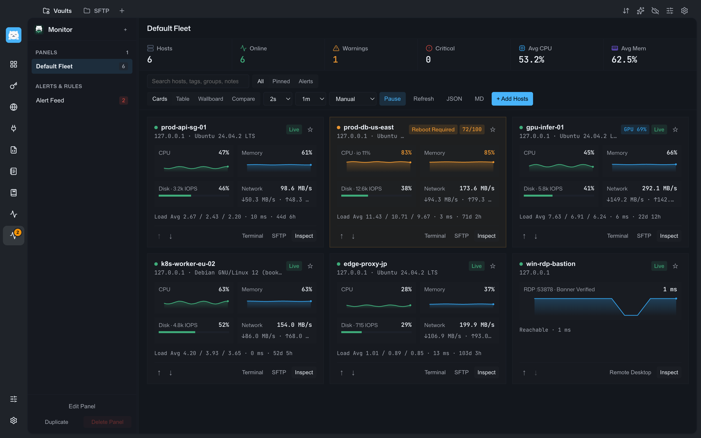
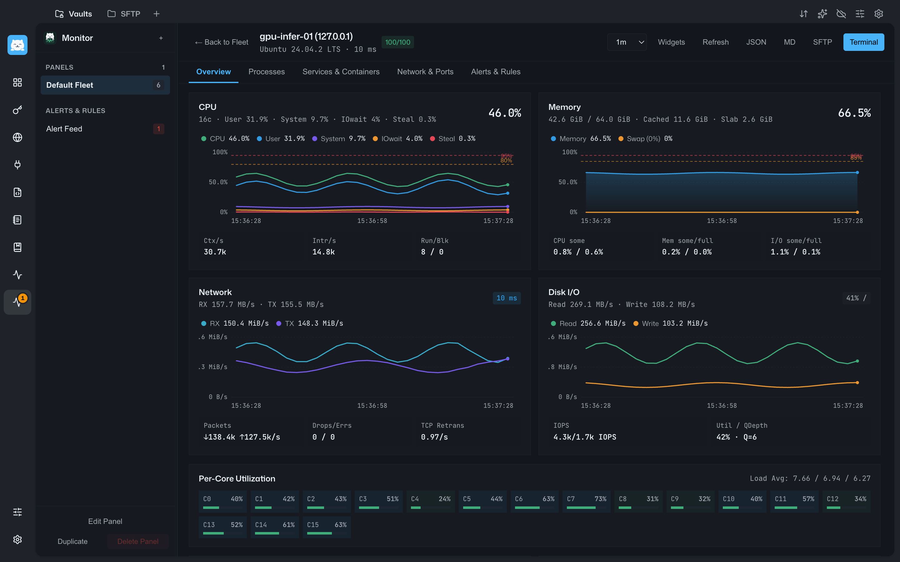
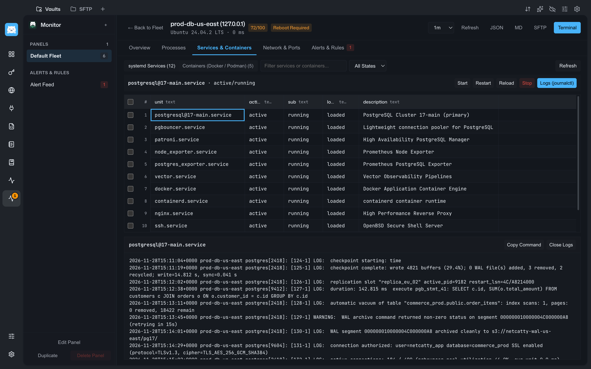
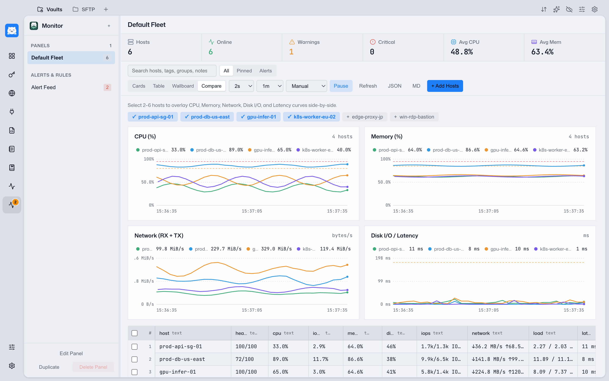

<p align="center">
  <picture>
    <source media="(prefers-color-scheme: dark)" srcset="assets/plugin-icon-dark.svg">
    <source media="(prefers-color-scheme: light)" srcset="assets/plugin-icon-light.svg">
    
  </picture>
</p>

<h1 align="center">Netcatty Monitor</h1>

<p align="center">
  <strong>Agentless SSH server fleet observability &amp; operations workbench built natively for Netcatty's Host-Rendered Plugin Platform.</strong>
</p>

<p align="center">
  <a href="https://github.com/binaricat/netcatty-monitor-plugin/actions/workflows/ci.yml"></a>
  
  
  
  
  <a href="LICENSE"></a>
</p>

<p align="center">
  <picture>
    <source media="(prefers-color-scheme: dark)" srcset="docs/screenshots/monitor-fleet-dark.png">
    <source media="(prefers-color-scheme: light)" srcset="docs/screenshots/monitor-compare-light.png">
    
  </picture>
</p>

<p align="center">
  Zero Remote Agents · 4 Fleet Views (Cards · Table · Wallboard · Compare) · Linux CPU Breakdown &amp; PSI · Storage Inodes &amp; IOPS · Network Drops &amp; TCP Retransmits · GPU &amp; Thermals · Processes · systemd / Docker / Podman Controls &amp; Log Tails · Listening Ports &amp; Security Audit · Hysteresis Alerts &amp; Live Vault Sidebar Badge · RDP / VNC Reachability Probes
</p>

---

## Install in Netcatty

1. Open **Netcatty → Settings → Plugins → Install from GitHub** and enter:
   ```text
   binaricat/netcatty-monitor-plugin
   ```
2. Or download `netcatty-monitor-0.1.0.ncpkg` from the [latest GitHub Release](https://github.com/binaricat/netcatty-monitor-plugin/releases/latest) and import it via **Settings → Plugins → Manage → Import**.

---

## Highlights (`v0.1.0`)

- **100% Agentless & Browser-Sandbox Isolated (`main.browser`)** — Runs entirely inside Netcatty's ordinary offline browser plugin sandbox using host-rendered React UI (`@netcatty/plugin-sdk/host-react`), zero iframes, zero inline `<svg>`/`<canvas>`, and zero remote agents to deploy. Reuses Netcatty Vault's pooled SSH connections and durable host bindings without ever exposing host credentials.
- **4 Fleet View Modes**:
  - **Cards**: Calm Netcatty-native host cards with live CPU/Memory sparklines, disk & IOPS bars, network throughput, GPU/Reboot indicators, health scores, and one-click jump to **Terminal**, **SFTP**, or **Remote Desktop** (RDP/VNC).
  - **Table**: Virtualized fleet inventory via `PluginDataGrid` with customizable columns (including IOPS, Packet Drops, GPU, Load, Uptime, Latency, and Tags).
  - **Wallboard (NOC)**: High-density compact status tiles built for scanning large fleets at a glance.
  - **Compare Mode**: Overlay **2–6 hosts** simultaneously across 4 synchronized `PluginMetricChart` panels (CPU, Memory, Network, Latency) plus a live side-by-side KPI grid.
- **Deep Multi-OS Telemetry**:
  - **Linux**: CPU breakdown (`user` / `system` / `iowait` / `steal` / `idle`), context switches/s, interrupts/s, runnable/blocked threads, color-coded Per-Core Heatmap; Active/Slab memory + **Linux PSI** (`/proc/pressure/{cpu,memory,io}`); storage **Inodes** (`df -iP`), Read/Write **IOPS**, `%util`, Queue Depth, and system-mount grouping with >80% auto-expand alerts; network packet rates (`pps`), RX/TX errors & drops, **TCP Retransmits/s**; NVIDIA/AMD GPU stats & thermal sensors; Open FDs, active users, and pending reboot detection.
  - **macOS, FreeBSD / OpenBSD / NetBSD & Windows-OpenSSH**: Native telemetry parsers preserving Netcatty's multi-OS parity, plus **RDP / VNC TCP + banner reachability probes** via `vault.probeHost`.
- **Operational Workbench Tabs** (active-tab-only polling):
  - **Overview**: Symmetrical 2×2 multi-series charts, customizable widget visibility (`PluginPopover`, persisted per user), `1m / 5m / 15m / 30m / 1h` time windows, and one-click **JSON** & **Markdown** diagnostics export.
  - **Processes**: Top-5 CPU & Memory strip, state filter (`All` / `Running` / `Sleeping` / `Zombie`), full command inspector, and confirm-gated `SIGHUP` / `SIGTERM` / `SIGKILL`.
  - **Services & Containers**: `systemd` units + Docker/Podman containers with confirm-gated `Start` / `Stop` / `Restart` / `Reload` lifecycle actions and live `journalctl` / `docker logs` tail viewer.
  - **Network & Ports + Security Audit**: Listening TCP/UDP ports (`ss` / `netstat` / `lsof`), socket states (including `SYN_RECV`), plus Open FDs, logged-in users, 24h failed SSH auth attempts, and recent logins.
  - **Alerts & Incident Timeline**: Configurable warning/critical thresholds (CPU, IOwait, Memory, Swap, Disk, Inodes, Load/Core, Net Drops, Latency) with **hysteresis** (`consecutivePolls`, default `2`) and live Netcatty Vault sidebar badge (`views.setBadge`).
- **Full Bilingual UI (English & 简体中文)** — Adapts automatically to Netcatty's locale and Midnight Dark / Snow Light themes.

---

## Screenshots

| Fleet Overview (Midnight Dark) | Host Deep Telemetry (Midnight Dark) |
| --- | --- |
|  |  |

| Services & Containers Workbench (Midnight Dark) | Multi-Host Compare View (Snow Light) |
| --- | --- |
|  |  |

---

## Build, Test & Package

Node `>=22` and npm are required. Vendored `@netcatty/plugin-{contract,sdk,cli}` snapshots and pinned stylesheet policy live in `vendor/`.

```sh
shasum -a 256 -c vendor/SHA256SUMS
npm ci --ignore-scripts
npm run lint
npm test
npm run pack
npm run validate
```

The packaged plugin is written to `dist/netcatty-monitor-0.1.0.ncpkg` alongside `dist/SHA256SUMS`.

---

## Security & Licenses

- Runs strictly as a **browser-only** Netcatty plugin (`main.browser: "browser.js"`). All SSH host executions (`vault.hostExec`), TCP reachability probes (`vault.probeHost`), host metadata resolution (`vault.metadata`), native confirmation/save dialogs (`ui.interact`), and clipboard writes are mediated and user-approved by the Netcatty host without exposing SSH keys or passwords.
- Service/container names and PIDs are strictly allowlist-validated before command construction, and all mutating process/service/container actions require explicit user confirmation.
- Plugin source code and vendored Netcatty SDK/contract/CLI snapshots are licensed under **GPL-3.0-or-later**. See [LICENSE](LICENSE), [NOTICE](NOTICE), and [SECURITY.md](SECURITY.md).
